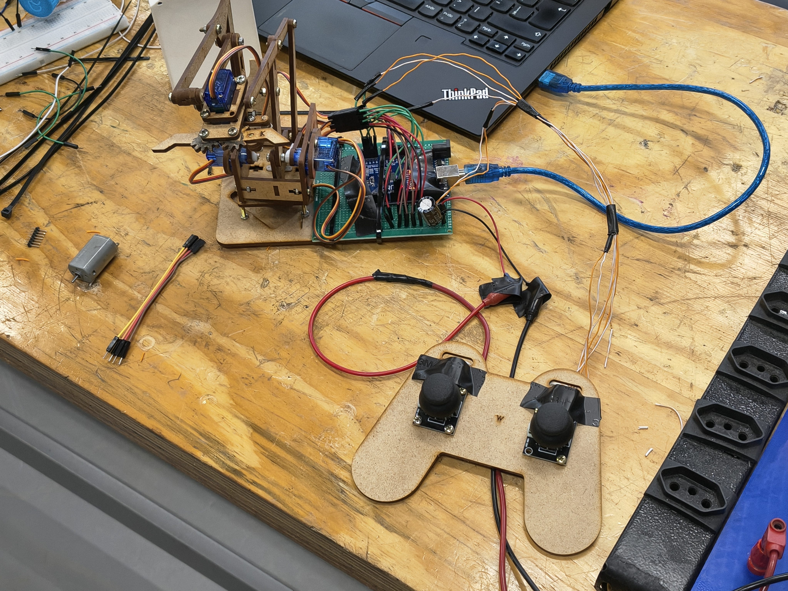

# Braço Robótico Manipulador (4 DOF) com Controle Joystick

Projeto de um braço robótico de 4 graus de liberdade (4 DOF) construído em estrutura de MDF, acionado por micro servos SG90 e controlado por um Arduino Uno através de um suporte de joystick analógico duplo.

---

## 📌 Visão Geral

O projeto permite o controle preciso e em tempo real das articulações de um manipulador robótico. A estrutura conta com 4 graus de liberdade operados por dois joysticks analógicos bidimensionais:
1. **Base:** Rotação horizontal.
2. **Ombro:** Articulação de elevação primária.
3. **Cotovelo:** Articulação de alcance secundário.
4. **Garra:** Mecanismo de abertura e fechamento para manipulação de objetos.

---

## 🛠️ Hardware e Componentes

* **Microcontrolador:** Arduino Uno (ou placa compatível)
* **Atuadores:** 4x Micro Servos TowerPro SG90 (9g)
* **Entradas:** 2x Módulos Joystick Analógico Dual-Axis (KY-023 / PS2)
* **Estrutura:** Chassi do braço e base do controle recortados em MDF (projeto do [braço robotico makerhero](https://github.com/makerhero/braco-robotico-arduino))
* **Eletrônica Auxiliar:**
  * Placa padrão perfurada / ProtoShield para organização da fiação de alimentação
  * Capacitor eletrolítico (ex: 470µF a 2000µF / 16V) para desacoplamento e mitigação de picos de corrente nos servos
  * Fonte de alimentação DC externa de 5V (mínimo 2A recomendado)

---

## 🔌 Tabela de Conexões (Pinout Sugerido)

| Componente / Sinal | Pino Arduino | Função |
| :--- | :--- | :--- |
| **Servo Base** | `D3` (PWM) | Rotação azimuthal |
| **Servo Ombro** | `D5` (PWM) | Elevação do braço |
| **Servo Cotovelo** | `D6` (PWM) | Extensão da haste |
| **Servo Garra** | `D9` (PWM) | Acionamento da garra |
| **Joystick 1 - Eixo X** | `A0` | Controle de rotação da base |
| **Joystick 1 - Eixo Y** | `A1` | Controle de elevação do ombro |
| **Joystick 2 - Eixo X** | `A2` | Controle do cotovelo |
| **Joystick 2 - Eixo Y** | `A3` | Controle de abertura da garra |

> ⚠️ **Recomendação Elétrica:** Nunca alimente a linha de VCC dos 4 servos diretamente pela saída de 5V do Arduino, pois o pico de corrente pode causar *reset* por *brownout*. Utilize fonte de alimentação dedicada de 5V e una os **GNDs** da fonte e do Arduino.

---

## `main.cpp`  
[https://github.com/FLY0x1122/braco-robotico/blob/master/src/main.cpp](https://github.com/FLY0x1122/braco-robotico/blob/master/src/main.cpp)
